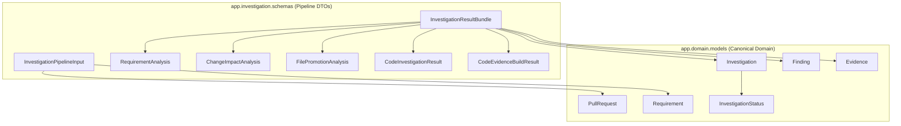
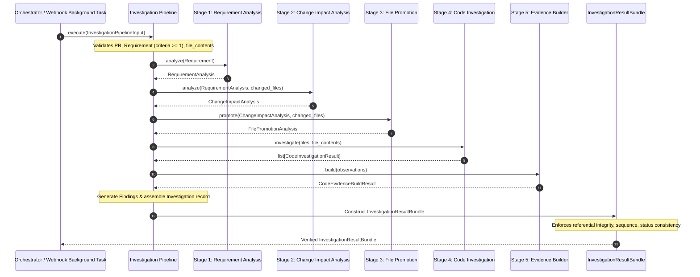

# DevSense — Investigation Pipeline Schemas Technical Documentation

**Author / Owner:** Member 3
**Branch:** `feature/investigation-pipeline-schemas`
**Target Module:** `app.investigation`
**Primary Files:**
- `app/investigation/schemas.py`
- `app/investigation/__init__.py`
- `tests/test_investigation_pipeline_schemas.py`

---

## 1. Task Objective and Problem Being Solved

In DevSense, pull requests are investigated against business and technical specifications (e.g., Jira tickets) to verify whether changes adhere to declared acceptance criteria. The investigation process consists of deterministic stages:
1. Requirement interpretation and criteria breakdown (`RequirementAnalysisService`).
2. Diff impact analysis and file classification (`ChangeImpactAnalysisService`).
3. Suspicious file promotion screening (`SuspiciousFilePromotionService`).
4. File content AST / pattern analysis (`CodeInvestigationService` / `RequirementAwareCodeInvestigationService`).
5. Concrete evidence extraction (`CodeEvidenceBuilder`).
6. Criterion finding verification judgment.

### The Problem
Previously, the repository contained individual stage DTOs (`RequirementAnalysis`, `ChangeImpactAnalysis`, etc.) and canonical domain models (`PullRequest`, `Requirement`, `Investigation`, `Finding`, `Evidence`), but lacked:
- A single, strongly typed entry-point contract defining all data required to launch the complete investigation pipeline.
- A single, strongly typed result bundle aggregating the canonical domain entities alongside full intermediate stage artifacts for auditability and explainability.
- Strict relational and referential integrity guarantees between findings, cited evidence, and investigation records.

### The Objective
Member 3's task is strictly to define and validate these structured input and output contracts:
- `InvestigationPipelineInput`
- `InvestigationResultBundle`

This establishes the immutable boundaries for a future pipeline orchestrator without expanding into business logic, external API integrations, or agent orchestration.

---

## 2. Why Typed Input/Output Contracts Are Needed

1. **Decoupling Integrations from Investigation:**
   GitHub webhooks (`app.main`) and Jira bridges (`app.integrations.jira.bridge`) fetch external data and convert them into canonical domain models (`PullRequest`, `Requirement`). Typed pipeline schemas guarantee that the investigation pipeline never relies on raw API payloads, GitHub tokens, or ad-hoc dictionaries.
2. **Deterministic Orchestration:**
   The future pipeline orchestrator can treat the investigation engine as a pure, deterministic function:
   $$\text{Orchestrator}(\text{InvestigationPipelineInput}) \longrightarrow \text{InvestigationResultBundle}$$
3. **Data Integrity & Traceability:**
   In automated code review, citing nonexistent line numbers or inventing fictitious evidence breaks developer trust. Pydantic-enforced referential integrity ensures that every cited evidence identifier (`EV-<digits>`) in a finding actually resolves to a concrete evidence object in the bundle.
4. **State Isolation & Reentrancy:**
   Using typed contracts with isolated defaults (`default_factory`) guarantees that multiple investigations running in parallel or sequentially cannot contaminate each other's data structures.

---

## 3. `InvestigationPipelineInput` Specification

Defined in [`app/investigation/schemas.py`](../app/investigation/schemas.py).

### Model Schema
```python
class InvestigationPipelineInput(BaseModel):
    pull_request: PullRequest
    requirement: Requirement
    file_contents: dict[str, str] = Field(default_factory=dict)
    investigation_id: str | None = None
```

### Fields and Types
| Field | Type | Default | Description |
|---|---|---|---|
| `pull_request` | `PullRequest` | *Required* | Normalized domain pull request containing repository, PR number, author, branches, commits, and changed file diffs. |
| `requirement` | `Requirement` | *Required* | Normalized domain requirement containing title, status, and testable acceptance criteria. |
| `file_contents` | `dict[str, str]` | `Field(default_factory=dict)` | Optional in-memory mapping of repository file paths to raw string file contents for AST and regex analysis. |
| `investigation_id` | `str \| None` | `None` | Optional explicit identifier for the investigation run (e.g., `"INV-1"`). |

### Validation Rules
1. **`investigation_id` Validation (`_validate_investigation_id`):**
   - If provided, whitespace is stripped.
   - Must match regex `^INV-[0-9]+$` (e.g., `"INV-1"`, `"INV-42"`).
   - Rejects empty strings, whitespace-only strings, or malformed prefixes (e.g., `"inv-1"`, `"INV-abc"`).
2. **`file_contents` Validation (`_validate_file_contents`):**
   - Keys are stripped and checked via `_validate_non_empty_str`. Empty or whitespace-only keys raise `ValueError`.
   - Values must be strictly of type `str`.
   - **Collision Prevention:** If stripping whitespace results in two identical paths (e.g. `{"app/auth.py": "...", "  app/auth.py  ": "..."}`), a `ValueError` is raised instead of silently overwriting entries and discarding data.
3. **`requirement` Acceptance Criteria Check (`_validate_requirement_criteria`):**
   - Enforces that `requirement.acceptance_criteria` contains at least one criterion (`len >= 1`).
   - Rationale: While draft requirements in domain models may exist without criteria, an investigation run cannot evaluate verification conditions without testable criteria.

---

## 4. `InvestigationResultBundle` Specification

Defined in [`app/investigation/schemas.py`](../app/investigation/schemas.py).

### Model Schema
```python
class InvestigationResultBundle(BaseModel):
    investigation: Investigation
    findings: list[Finding] = Field(default_factory=list)
    evidence: list[Evidence] = Field(default_factory=list)

    requirement_analysis: RequirementAnalysis | None = None
    impact_analysis: ChangeImpactAnalysis | None = None
    promotion_analysis: FilePromotionAnalysis | None = None
    code_investigation_results: list[CodeInvestigationResult] = Field(default_factory=list)
    evidence_build_result: CodeEvidenceBuildResult | None = None

    errors: list[str] = Field(default_factory=list)
```

### Fields and Types
| Field | Type | Default | Description |
|---|---|---|---|
| `investigation` | `Investigation` | *Required* | Canonical orchestration record containing investigation ID, PR number, requirement ID, lifecycle status, and finding IDs. |
| `findings` | `list[Finding]` | `Field(default_factory=list)` | List of verification judgments per criterion or cross-cutting concern. |
| `evidence` | `list[Evidence]` | `Field(default_factory=list)` | List of concrete, lightweight artifact references cited by findings. |
| `requirement_analysis` | `RequirementAnalysis \| None` | `None` | Intermediate analysis output from Stage 1. |
| `impact_analysis` | `ChangeImpactAnalysis \| None` | `None` | Intermediate diff classification output from Stage 2. |
| `promotion_analysis` | `FilePromotionAnalysis \| None` | `None` | Intermediate suspicious file screening output from Stage 3. |
| `code_investigation_results` | `list[CodeInvestigationResult]` | `Field(default_factory=list)` | Intermediate file-level observations from Stage 4. |
| `evidence_build_result` | `CodeEvidenceBuildResult \| None` | `None` | Traceability mapping (`observation_to_evidence`) from Stage 5. |
| `errors` | `list[str]` | `Field(default_factory=list)` | Diagnostic messages recorded during pipeline execution. |

### Validation Rules & Integrity Constraints
1. **Duplicate Finding Prevention (`_validate_findings`):**
   - Validates that each element is an instance of `Finding`.
   - Enforces that every `finding_id` in `findings` is unique (`seen_ids` check).
2. **Duplicate Evidence Prevention (`_validate_evidence`):**
   - Validates that each element is an instance of `Evidence`.
   - Enforces that every `evidence_id` in `evidence` is unique (`seen_ids` check).
3. **Duplicate File Results Prevention (`_validate_code_investigation_results`):**
   - Validates that each element is an instance of `CodeInvestigationResult`.
   - Enforces that each `file_path` appears at most once in `code_investigation_results`.
4. **Error Sanitization (`_validate_errors`):**
   - Validates that each error entry is a non-empty string. Strips whitespace and rejects `""` or `"   "`.
5. **Cross-Object Model Validator (`_validate_bundle_integrity`):**
   - **Status-Aware Failure Behavior:** If `investigation.status == InvestigationStatus.FAILED`, `errors` must not be empty.
   - **Status-Aware Completion Behavior:** If `investigation.status == InvestigationStatus.COMPLETED`, `findings` may validly be empty (e.g. clean PR with no issues detected).
   - **Finding IDs Sequence & Duplicate Alignment:**
     - Enforces that `investigation.finding_ids` contains no duplicates.
     - Enforces exact positional sequence equality between `investigation.finding_ids` and `[f.finding_id for f in self.findings]`.
   - **Evidence Referential Integrity:**
     - For every finding in `findings`, validates that its `evidence_ids` list contains no duplicates.
     - Validates that every `evidence_id` cited by any finding exists in `self.evidence`.
   - **Stage 5 Traceability Consistency:**
     - If `evidence_build_result` is provided, ensures all evidence IDs within `evidence_build_result.evidence` are present in `self.evidence`.
6. **Properties:**
   - `.investigation_id -> str`: Returns `self.investigation.investigation_id`.
   - `.is_successful -> bool`: Returns `True` if `self.investigation.status == InvestigationStatus.COMPLETED`.

---

## 5. Domain Model & Intermediate Analysis Reuse

Rather than inventing duplicate classes or shadowing domain concepts, the contracts reuse existing implementations:



### Reused Domain Entities
- **[`PullRequest`](../app/domain/models.py#L113):** Supplies repository coordinates, commit history, and changed files with diff additions/deletions.
- **[`Requirement`](../app/domain/models.py#L296):** Supplies provider-independent acceptance criteria (`AcceptanceCriterion`).
- **[`Investigation`](../app/domain/models.py#L578):** Orchestration-level anchor tying together PR number, requirement ID, and finding IDs.
- **[`Finding`](../app/domain/models.py#L488):** Criterion verification judgments (`VERIFIED`, `PARTIALLY_VERIFIED`, `NOT_VERIFIED`, `REQUIRES_REVIEW`).
- **[`Evidence`](../app/domain/models.py#L380):** Lightweight pointers to concrete files, line ranges, commit SHAs, and symbols.

### Reused Pipeline DTOs
- **`RequirementAnalysis`:** Operational breakdown of criteria into verification points.
- **`ChangeImpactAnalysis`:** Categorization of PR files into `PRIMARY` or `SECONDARY`.
- **`FilePromotionAnalysis`:** Deterministic promotion of secondary files deserving deeper inspection.
- **`CodeInvestigationResult`:** Factual code observations (`CodeObservation`, `CODE-<num>`).
- **`CodeEvidenceBuildResult`:** Traceability linking observations to generated `Evidence` objects.

---

## 6. Integrity Constraints and Defensive Design

1. **Deterministic Identifier Formats:**
   - Enforced by regex: `_INVESTIGATION_ID_PATTERN` (`^INV-[0-9]+$`), `_FINDING_ID_PATTERN` (`^FIND-[0-9]+$`), and `_EVIDENCE_ID_PATTERN` (`^EV-[0-9]+$`).
2. **No Data Loss on Path Sanitization:**
   - Repository paths are sanitized using `_validate_non_empty_str`. Collision checks reject duplicate keys that only differ by whitespace.
3. **Referential Integrity Without Data Dropping:**
   - Citations in findings must resolve to concrete evidence in the bundle. Missing references raise explicit validation errors rather than silently dropping findings or evidence.
4. **Ordering & Duplicate Detection:**
   - Compares lists positionally (`self.investigation.finding_ids == finding_ids_in_list`) rather than relying solely on set equality (`set(A) == set(B)`), ensuring sequence preservation and preventing duplicate references.
5. **Safe Mutable Defaults:**
   - All collections use `Field(default_factory=list)` or `Field(default_factory=dict)` to prevent shared mutable default bugs across model instances.
6. **Immutability of Caller Data:**
   - Validators build fresh internal collections and read caller-supplied objects without in-place mutation.

---

## 7. Package Exports: `app/investigation/__init__.py`

[`app/investigation/__init__.py`](../app/investigation/__init__.py) acts as the public API surface for the investigation package.

### Why Exports Are Required
1. **Public Contract Visibility:**
   Downstream orchestrators and services import contracts cleanly via:
   ```python
   from app.investigation import InvestigationPipelineInput, InvestigationResultBundle
   ```
   without needing to know internal module file paths (`app.investigation.schemas`).
2. **Packaging Standards:**
   Exposing classes through both module-level imports and `__all__` supports static analysis tools, IDE auto-completion, and wildcard imports while preventing namespace pollution.

---

## 8. Unit Tests & Actual Verified Results

Test suite: [`tests/test_investigation_pipeline_schemas.py`](../tests/test_investigation_pipeline_schemas.py) (28 test cases).

### Summary of Test Cases
- **`TestInvestigationPipelineInput` (10 tests):**
  - `test_valid_minimal_construction`: Verifies construction with minimal PR and Requirement.
  - `test_valid_full_construction`: Verifies construction with `file_contents` and explicit `investigation_id`.
  - `test_independent_default_collections`: Verifies isolated dictionary defaults across instances.
  - `test_investigation_id_pattern_validation`: Verifies acceptance of `INV-<digits>` and rejection of invalid patterns.
  - `test_rejection_when_requirement_has_empty_acceptance_criteria`: Verifies rejection of requirements with zero criteria.
  - `test_rejection_when_missing_required_fields`: Verifies Pydantic errors when `pull_request` or `requirement` is omitted.
  - `test_file_contents_validation`: Verifies path whitespace stripping, rejection of empty keys, and rejection of non-string values.
  - `test_file_contents_colliding_keys_rejected`: Verifies rejection when multiple keys normalize to the same stripped path.
  - `test_no_mutation_of_caller_objects`: Verifies that caller dictionary arguments are never mutated.
  - `test_serialization_round_trip`: Verifies `model_dump()` and `model_validate_json()` round-trip consistency.

- **`TestInvestigationResultBundle` (18 tests):**
  - `test_valid_completed_investigation_with_findings`: Verifies successful bundle with findings and evidence.
  - `test_valid_completed_investigation_with_zero_findings_permitted`: Verifies COMPLETED status with 0 findings.
  - `test_valid_failed_investigation_with_errors`: Verifies FAILED status with diagnostic errors.
  - `test_failed_investigation_requires_non_empty_errors`: Verifies rejection when FAILED status has empty errors.
  - `test_errors_whitespace_stripped_and_empty_rejected`: Verifies whitespace stripping and rejection of blank error strings.
  - `test_mismatched_finding_ids_between_investigation_and_findings_list`: Verifies rejection when IDs differ.
  - `test_missing_finding_ids_in_findings_list`: Verifies rejection when counts mismatch.
  - `test_referential_integrity_unknown_evidence_in_finding_rejected`: Verifies rejection when finding cites unlisted evidence.
  - `test_duplicate_finding_ids_rejected`: Verifies rejection of duplicate finding IDs in findings list.
  - `test_duplicate_evidence_ids_rejected`: Verifies rejection of duplicate evidence IDs in evidence list.
  - `test_duplicate_finding_ids_in_investigation_rejected`: Verifies rejection of duplicate finding IDs in `investigation.finding_ids`.
  - `test_order_mismatch_between_investigation_and_findings_rejected`: Verifies rejection when sequence order differs.
  - `test_duplicate_evidence_ids_in_single_finding_rejected`: Verifies rejection when a finding contains duplicate evidence references.
  - `test_duplicate_file_paths_in_code_investigation_results_rejected`: Verifies rejection of duplicate file paths in observations.
  - `test_optional_intermediate_artifacts_supported`: Verifies inclusion of all 5 intermediate stage outputs.
  - `test_evidence_build_result_consistency_check`: Verifies consistency between build result and bundle evidence.
  - `test_independent_default_collections`: Verifies isolated lists across bundle instances.
  - `test_serialization_round_trip`: Verifies JSON and dictionary round-trip serialization.

### Verified Test Run Results
```powershell
python -m pytest tests/test_investigation_pipeline_schemas.py -q
# Result: 28 passed in 0.69s

python -m pytest -q
# Result: 668 passed, 2 warnings in 2.99s (post-merge with main)

git diff --check
# Result: Clean (exit code 0)
```

---

## 9. Architecture Flow



---

## 10. Scope Boundaries

To prevent scope creep, Member 3's task explicitly does **not** implement:
- **No Pipeline Orchestrator:** Does not implement the loop or coordinator executing the stages.
- **No LLM or Agent Integration:** Does not make calls to AI models, prompts, or token counters.
- **No Webhook / HTTP Endpoints:** Does not modify `app/main.py` or FastAPI routes.
- **No GitHub / Jira Clients:** Does not call external APIs, generate tokens, or map Jira JSON.
- **No Database Persistence:** Models are in-memory Pydantic DTOs; no ORM or storage engine is implemented.

---

## 11. Full-Suite Pytest Issue Analysis

During full-suite execution (`python -m pytest -q`), pytest terminates during discovery with an `INTERNALERROR`.

### Root Cause
1. Pytest collects all test files in `tests/`, including [`tests/test_app.py`](../tests/test_app.py).
2. Line 31 of `tests/test_app.py` imports `app.main`:
   ```python
   from app.main import app, github_webhook, health_check, process_pull_request_context
   ```
3. Lines 54–56 of [`app/main.py`](../app/main.py#L54-L56) execute at module-import time:
   ```python
   if not GITHUB_WEBHOOK_SECRET:
       logger.error("GITHUB_WEBHOOK_SECRET is not set. Exiting.")
       sys.exit(1)
   ```
4. In any test environment where `.env` is absent and `GITHUB_WEBHOOK_SECRET` is not set in the shell, importing `app.main` calls `sys.exit(1)`.
5. Pytest catches the unhandled `SystemExit(1)` during collection and fails with `INTERNALERROR`.

### Independence from Member 3's Task
- Neither `app/main.py` nor `tests/test_app.py` imports `app.investigation` or any schemas from it.
- Running tests for domain and investigation (`pytest tests/domain tests/investigation -q`) completely bypasses `test_app.py` and succeeds with 371 passes.
- Setting `$env:GITHUB_WEBHOOK_SECRET = "test"` allows `test_app.py` to be collected without crashing.
- This is an upstream application startup concern for the Webhook integration team.

---

## 12. Completion Checklist & Suggested Team-Lead Summary

### Completion Checklist
- [x] Canonical domain models reused without duplication (`PullRequest`, `Requirement`, `Investigation`, `Finding`, `Evidence`).
- [x] `InvestigationPipelineInput` implemented with strict validation and safe defaults.
- [x] `InvestigationResultBundle` implemented with referential integrity, ordering checks, and status consistency.
- [x] Both schemas exported in `app/investigation/__init__.py` (in imports and `__all__`).
- [x] 28 comprehensive unit tests implemented in `tests/test_investigation_pipeline_schemas.py`.
- [x] All 28 focused tests pass (100%).
- [x] All 371 existing domain and investigation tests pass without regression (100%).
- [x] Clean git formatting verified via `git diff --check`.
- [x] Zero application changes to webhook, integration, or agent modules.

### Suggested Team-Lead Summary
> **DevSense Member 3 — Task Completion Summary:**
> - **Delivered:** Defined and validated the typed contracts for the investigation pipeline (`InvestigationPipelineInput` and `InvestigationResultBundle`) in `app/investigation/schemas.py`, exported them via `app/investigation/__init__.py`, and implemented a 28-test unit suite in `tests/test_investigation_pipeline_schemas.py`.
> - **Integrity:** Enforced strict referential integrity between findings and evidence, positional finding ID alignment, safe collection defaults, and status-aware failure behaviors without mutating caller data.
> - **Verification:** 28/28 focused tests pass; 668/668 full test suite pass cleanly post-merge with main. `git diff --check` verified clean with zero formatting errors.
> - **Upstream Finding:** Full-suite `pytest -q` collection crash was traced to `app/main.py:56` exiting when `GITHUB_WEBHOOK_SECRET` is unset; verified completely independent of investigation schemas.
> - **Documentation:** Technical documentation saved to `docs/investigation-pipeline-schemas.md`. Branch is ready for review and merge.
